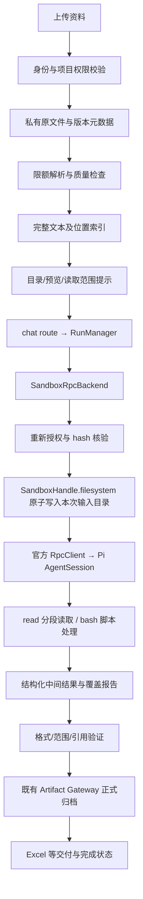

# 项目大文档完整读取与结构化处理方案

> 日期：2026-10-11。状态：方案 A 已实现并完成隔离验证；B/C 仍为设计。依据当前工作树（含正在开发的项目共享）及 Pi 1.1.0 官方实现核对。本文不代表已具备原件版本库、可信覆盖门禁、检索、OCR、Worker、后台任务恢复或容量验收能力。

## 本轮实施状态

完整限额文本提取/保存、目录+512字符预览、宿主 projectSources reference grant、真实 run/共享权限复核、32KiB UTF-8 无损分块、原子物化及最后提交 manifest 已实现。默认启用，PIWORK_PROJECT_DOCUMENT_INPUTS_ENABLED=0 回滚旧预览但明确范围不足。物化120s协作取消；开启输入的启动失败 kill并核验状态。文本单份2MiB/合计8MiB/50份，manifest/index 单文件最多128KiB；官方 read 返回较短时仍按 offset 续读。解析60s协作取消及2MiB输出限额不等同硬内存/时间隔离。

资料列表显示已存字符数与已知历史截断告警；无截断标记只能表示完整性未核验。模型分批保存结果/检查覆盖通过提示约定，不是宿主强制门禁。既有项目聊天已固定经典 SandboxRpc，本轮沿用该路由，不新开 Durable 或宿主执行能力。新增 test:projects:documents、:db、:http；49项相关单测/RPC/RunManager、2项独立schema授权及独立Next上传HTTP验证通过（无真实模型），全仓 tsc 和本轮文件 Biome 检查通过。已有 collector 测试的只读 NODE_ENV delete 改为等价 Reflect.deleteProperty；真实 Docker collector 测试未启用、默认跳过。

下文为完整目标设计；“原件版本/页码/可信覆盖/Worker”等 B/C 内容均未实现。已有民航 Source 后半段可达，不自动重放原用户任务或改写已交付 Excel。

## 1. 目标与已确认问题

用户在项目中上传资料后，应能问答、总结、全文提取以及生成 Excel 等制品；超过模型一次输入范围时，保留完整资料，通过工具继续读取。不得把“未读取”“解析失败”“超过预算”表述为“原资料未提供”。

本次故障证据：项目 a3d86e16-3b3a-474c-8727-e32693770a7e 的「人工智能+航空.pdf」Source.content 长 24,965 字符；context.ts 的 20,000 字符切片落在场景 31 应用场景中段，后续 4,965 字符含场景 32–42 正文。用户消息无 file part，项目原文件不随资料上下文进入沙箱。运行为 sandbox_rpc / qwen3.8-max，正常 settled 并不能证明产物内容完整。

现有三层问题：

1. extractSourceText 复用 extractAttachmentText；后者提取后在 60,000 字符切断，可能将不完整文本直接存入 Source。仅修上下文无法恢复这类历史数据。
2. 项目提示词单资料上限 20,000、总量 80,000 字符；聊天附件单份 60,000、总量 150,000。总量切片可能丢掉截断标记或跳过后续资料。
3. 项目文档只存提取文本，图片存版本化 base64；原 PDF 不保留于 Source。宿主 workspace 与沙箱路径不等价，宿主写入成功不能证明模型可读。

另有独立问题：模型生成大段脚本可触发输出限制；分批写入解决输出问题，不补回输入内容。须分别报告。

## 2. 核心决策

- 完整资料与提示词预算分开：存储完整内容，按预算展示；显示预算不决定保存长度。
- 第一阶段补齐 SandboxRpc 输入文本物化和官方 read 分段读取，不重写 Pi agent loop/RPC/compaction，不引入新后端。
- 原文件长期私有保留；现有资料可先以已存文本工作，原文件缺失明确标记，不能虚构页码或全文完整性。
- 问答允许按需定位；“全部/逐项/清单/全文审查”按所有相关分段处理，不能只靠 top-k 检索。
- 授权在宿主查询与物化时执行；模型不提供 userId/宿主路径/存储 key。可信 Runtime 元数据不等同可序列化 Worker DTO。
- 沿用当前工作树所有项目聊天固定经典 SandboxRpc 的约束，提供沙箱完整资料；非项目轻量问答不因本方案开启宿主执行工具。
- 项目资料处理在已有聊天链路完成；不接非生产 Durable，不改变其生产门禁。后台任务与恢复另设阶段。

## 3. 目标链路

解析入口第一阶段保持现有 officeparser，但解除“存储前预览截断”；必须有输出大小、解压、时间和取消限制。后续复杂/不可信文档解析移入受限解析沙箱，不能借此开放任意宿主脚本、OCR 或网络访问。

## 4. 分期数据设计

### A：利用当前 Source 的完整可用文本

不立即新增大量业务表。新增宿主资料快照契约：sourceId、项目身份、displayName、type、textHash、UTF-8 bytes、字符/行计数、completeness、sourceVersion。查询结果必须包括 Source.id；排序使用 createdAt + id，避免相同时间不稳定。

completeness 值建议：verified_complete、legacy_unknown、known_truncated、parse_partial。历史无解析证据的 Source 标 legacy_unknown；仅发现截断标记可确定 known_truncated，没标记不能反推 verified_complete。当前民航文本可作为回归输入，全部字段来自现有文本；这不证明原 PDF 所有页面均解析成功。

每个 run 保存 manifest 与输入 hash；在 RuntimeSpec 增加仅宿主可信的 projectSources reference/grant，设计需与已有 skills/durableChat 模式对齐。DB 实体权限与读取由 db/project-queries.ts（或专项查询模块）持有，模型工具不访问 DB。

### B：原件与可追溯解析版本

新增 ProjectSourceRevision（具体迁移号以实施时为准），关联现有 Source：revisionId、sourceId、原件私有 key/hash/bytes/MIME、提取文本私有 key/hash/bytes、parserName/version/configHash、处理状态、质量告警、页数（可空）、位置索引 key、创建时间。Source 指向当前 revision，原 Source.content 保持兼容投影，逐步迁移为有界预览。

状态建议 pending → processing → ready | partial | failed；它是文档处理状态，不能混入 AgentRun.status。写入 staging、解析/核验后再原子发布 ready revision，失败清理孤立字节；旧有效版本继续可用。hash 相同只复用同权限域的结果，不暴露跨用户相同文件信息。

页码必须来自解析器的实际位置映射；旧 toText 只有文本时使用行/字符区间引用。页码为 null，不用“章节近似页码”。OCR、表格、公式、图片分别记录提取能力与失败范围，非完整解析必须标 partial。

### C：可选搜索与长任务

资料很多时增加按 revision 的标题/关键词索引，再评估向量检索。chunkId = revisionId + 区间 + hash，检索结果带来源位置。切块目标以 token/字节双限额为准，章节优先、少量重叠；检索块与全文遍历块可不同，重叠须去重。全文任务依 manifest 枚举全部分段，不依赖召回率。

ProjectDocumentTask 仅在后台运行确有需求时引入：归属、输入 revision 集合/hash、任务规格、分段状态、结果引用、停止/失败原因。不得在本方案 A/B 中暗中建设 Worker；C 实施前单独定义领取、lease/fencing、唤醒、授权复核和副作用未知结果对账。

## 5. 沙箱输入物化

建议本次目录 `.piwork-inputs/<随机本次ID>/project/`，仅内部生成路径：

- manifest.json：资料展示名、revision/hash、完整性、字符/字节/行数、分段路径、来源定位。
- sources/<sourceId>/segments/000001.txt：限额文本块。
- sources/<sourceId>/index.json：章节和分段位置映射。
- originals/：B 阶段按任务需要复制授权原件；文本提取任务默认不重复复制原件。

块是按字节有界、UTF-8 边界安全的完整切分；原始文本逐块串联必须等于源文本，不因分页规范化丢字符。长单行须物理分片，不能生成超长 JSON 单行让 read 无法输出；展示换行映射保存为派生索引，不能伪装原始行号。

物化顺序：查权限/选定 revision → 读取私有数据并验证 hash/size → acquire 原始 handle → 用 filesystem.writeAtomic 逐块写入 → manifest 最后提交 → 核对可读路径 → 启动官方 Pi。限额/取消/缺少 filesystem/任意一块失败均关闭沙箱、释放 lease、run failed；不降级宿主、不给模型伪路径、不继续部分输入。

不得使用旧无界 readFile/writeFile；参考现有 skills 原子物化模式，但授权与来源是项目资料。文件名不直接作为目标路径，拒绝路径穿越、链接与特殊文件。Runtime 输入不夹带访问 token、对象存储 URL 或平台凭据。

平台私有原件不可写；沙箱工作副本可被 bash 修改，不声称只读 mount。引用基于源 revision/hash，覆盖报告只能由已授权 manifest/原始片段验证，不能盲信模型重写的 manifest。阶段 A 工作副本与中间结果仅本次运行可用；不承诺重启恢复。

## 6. 上下文与任务策略

提示词由“全部资料目录 + 可用完整性 + 小量预览 + 真实读取路径 + 用户问题”构成。目录本身也有预算，资料过多时分页索引；不能目录未列全却说“全部资料”。安全指令不因预算裁剪丢失。

预算优先使用模型实际 token 上限，预留系统/历史、工具返回、输出及 compaction 空间；无法可靠计数时使用保守估计并标记。字符上限只能作额外防护，不等于 token。初期建议目录/预览总预算不超过可用输入预算的 20%，其余用于历史与工具工作；需配置与真实模型验证，不能宣称适合所有供应商。

任务模式是平台处理建议，仍通过官方 Pi 会话执行：

| 模式 | 读取策略 | 完成条件 |
| --- | --- | --- |
| 局部问答 | 定位章节，读取命中及必要相邻段 | 回答带来源；未命中不等于原件无信息 |
| 全文总结 | 每个相关分段摘要，再汇总 | 全部分段覆盖，列出不可读内容 |
| 清单/字段提取 | 所有相关分段逐项提取并合并 | 覆盖、编号、去重、字段与引用检查 |
| 表格/数值计算 | 脚本读取结构化输入，计算后校验 | 范围、类型、行数和计算口径检查 |

第一阶段只对明确执行任务采用 exhaustive 提示/模板，不添加自建模型调度循环。超预算或分类不确定时显示限制；选定后失败不换后端。现有 Durable 自动分类器须对项目资料任务保守留经典链路，明确测试，不能把新增 projectSources 装配进四工具实验 lane。

## 7. 中间结果、覆盖与正确性

模型在沙箱按批写 results.jsonl，每条包含稳定编号、字段、sourceId/revision/hash、片段位置；每批后保存 progress.json，避免只靠对话记忆。输入中的指令为待处理数据，不加载资料目录中的 AGENTS.md/Skill/Extension，不执行文档自称的脚本。

验证分三级：

1. 技术完整：原件/文本 hash、分块重组、所有输入可读、解析状态。
2. 处理覆盖：计划中的每块已有结果或明确错误；重叠去重、所有引用在授权 manifest 范围、引用原文一致。
3. 内容准确：JSON schema、编号连续性（仅当文档确有连续编号）、重复/空字段、数值对账、关键段与首尾抽查；必要时模型复核/人工复核。

read 调用只能证明某段送入工具返回，不能证明模型理解或提取准确；模型自报 progress 也不是可信审计。A 阶段覆盖报告明确标“模型生成，已做结构检查”；B 阶段需可信宿主验证并绑定产物 hash 才可显示“已验证处理范围”。脚本读取全文同样不能证明全文语义提取正确。

通用聊天正常 settled 与资料任务完成度分开。可交付部分结果，但必须清楚标“部分完成”，列出未处理段，禁止“全部完成”。若要求强制完成门禁，B 阶段在 Artifact Gateway 宿主验证回调中核验 task manifest、报告和产物 hash；不能只用 system prompt 保证。

压缩复用 Pi 官方机制，中间文件提供后续重新读取入口；不能覆盖 SDK context state 或自写压缩循环。当前单 run 正常暂停/继续能力与跨重启恢复不同。新 run 重新校验输入及授权；无持久归档的中间文件丢失则从头处理，不能承诺恢复。

## 8. 权限与共享

按工作树现有 getProjectAccess/项目共享查询核验 owner 或正式启用协作成员；同时校验 chat 访问及所属项目。chat 可见并不自动授予 project/source 访问，fork 也不继承原资料权限。读取 API、预览、原件下载、hydration 每次都复核，不以客户端传来的 projectId/sourceId 作为授权。

A 阶段在物化前复核；本次已复制字节无法靠后验鉴权收回，运行中移除成员的停止与销毁须补齐才可宣称持续授权。后续每工具调用拦截的授权设计须核对官方扩展能力，不能假设 SandboxRpc 已具备宿主闭包桥。现阶段 revocation 保证范围公开说明。

项目删除/资料移除应停止关联处理任务、取消物化、回收沙箱并防止新下载；删除处理中的 revision 必须与发布事务协调，失败留下清理记录，不仅删除 DB 指针。既有公开 Blob 不因新私有存储方案自动迁移。

## 9. 限额与大文档支持范围

既有上传单份 20 MB 保持；大页数不等于大字节。A 的片段建议最大 32 KiB UTF-8（为官方 read 50 KiB 返回上限留空间），并满足 filesystem 单写限额。每份文本、单任务总文本、资料数、工具轮次、解析墙钟/内存、临时磁盘和最终产物字节必须配置上限并做准入；值须结合底座资源验证后确定，不以任意提高上下文代替。

处理超限返回明确可操作信息：缩小章节/选择资料/分批任务；原件可保留为未解析状态，不能保存前 N 字符并标 ready。扫描文档需单独 OCR 阶段，初期不支持则提示“未提取文本”，不把空结果当资料无内容。密码保护/损坏文档失败；含图文混排的 PDF 不声称纯文本覆盖图表。

禁止容量/持续负载/突发并发测试；资源限制测试使用边界 fixture，不作为千人容量证据。Token 当前角色额度缺乏硬预留，处理预算只作准入/尽力停止，不声称零超支。

## 10. 代码工作包与交付阶段

### A：修复完整文本可达性（优先）

- lib/ai/attachments.ts：拆分完整限额提取与提示词投影；返回长度/完整性，聊天预览保留独立预算。不得仅将 60,000 提到更大。
- lib/projects/source-files.ts、context.ts：处理完整可用文本、目录/分块 manifest 与 preview；错误与部分状态清楚。
- lib/db/project-queries.ts：资料快照返回 id/版本证据并集中权限查询，继续 getDb 复用。
- lib/runtime/protocol：新增宿主 projectSources reference-only 契约；跨进程输入不是字节/闭包。
- lib/runtime/backends/sandbox-rpc/project-sources.ts（拟新增）：获得 handle 后授权核验及原子物化，真实沙箱路径追加提示；在 Pi 启动前完成。
- chat route / routing：组装项目引用和任务范围；项目任务避开 Durable；保持 route → RunManager → Backend → Pi。
- UI：资料完整性/运行读取范围提示；给出“未读取/解析部分/原件缺失”，不展示内部宿主路径。

A 交付：当前民航例子的 20,000 后文本可达；新资料不会在 60,000 处静默保存截断；单 run 能处理超上下文资料。不是完整后台文档平台。

### B：原件与结果可追溯

私有原件存储、revision/索引迁移、原件授权下载、解析质量、页码映射、可信结构/覆盖验证与 Gateway 完成门禁。解析任务隔离及超限取消。旧 Source 分批显式迁移；无原件记录只迁文本，提示原件缺失；禁止推断补原件或未经同意联网找替代 PDF。

### C：规模化资料查询及后台任务（另行立项）

检索索引、可选 embedding、OCR 专项、持久任务 Worker/检查点/恢复/取消对账；以现有 P2/P3/D1 和 Worker 生产门禁为前置。并行 agent、后台调度或自动恢复均不作为 A/B 默认能力。

不提供未验证工期承诺；按 A 完成验收 → B → 根据真实使用需求选择 C 排期。

## 11. 测试与验收

测试放 tests/unit/ai、tests/unit/projects（如新增需更新命令）、tests/unit/runtime/backends/sandbox-rpc、tests/unit/db；替身 tests/support，数据 tests/fixtures，HTTP/浏览器 tests/e2e。拟新增 test:projects:documents、:db、:http，实施时写入 package.json 并同步 development.md/AGENTS.md。

| 组 | 核心验证 |
| --- | --- |
| 提取/投影 | 20,000、60,000、150,000 前后文本不在存储层丢失；超解析上限明确失败 |
| 分块 | UTF-8 边界、超长单行、空段、分页、重叠去重；重组 hash 与源一致 |
| 官方工具 | 使用实际 Pi 1.1.0 read offset/limit 及截断续读，首尾/后半段均可达 |
| Backend | TestSandboxProvider + faux 模型，通过官方 RpcClient 读取真实复制的分段；不是直接模拟工具响应 |
| 失败 | hash 改变、半途取消、filesystem 缺失、磁盘写失败、manifest 未提交、provider 失败；无 fallback、lease 清理 |
| 权限 | 非成员、被移除/disabled、跨项目 sourceId、chat 分享未授项目权、fork、运行时资料变更 |
| 验证 | 缺块、空字段、错误引用、伪造报告、篡改 manifest/产物；不得误标完整 |
| 数据/UI | 独立项目身份/schema 与 fixture；不触碰日常真实任务，UI 截获模型请求 |
| 真实沙箱 | 显式 opt-in OpenSandbox 功能探针验证后半段读取与归档；不当容量/安全/恢复证据 |

民航回归：使用完整 24,965 文本的授权测试副本或脱敏同结构 fixture；验证场景 31 成熟度可读、32–42 都有原文定位；42 行无重复、与来源名称/说明一致、Excel 可打开；不在备注中误写 PDF 缺失。准确性由人工对照源文抽查，不仅统计 42 行。真实模型复测须独立授权测试运行，不自动重放用户原对话。

## 12. 发布与回滚

A 使用 PROJECT_DOCUMENT_INPUTS_ENABLED（拟定）受控开关；先本机隔离测试，再独立真实沙箱探针。关闭开关恢复旧链路但必须保留“预览截断、结果可能不完整”的明确提示，不能回滚为静默截断。已保存完整文本不回切为短文本。

B 增量 schema 兼容旧读取；迁移先盘点 Source 完整性/原件可用性，输出 dry-run 报告；不覆盖未知记录。清理只删本方案新私有根与确认不再引用的版本，保留已归档结果。发布遵循项目既有部署流程，本次设计不部署、不改环境开关。

日志记录 revision/hash、总字节/分段数、物化耗时、失败阶段/错误码、验证范围，不记录全文/密钥/公开可访问原件地址。任务 UI 显示“读取中/已覆盖 x/y/部分失败/已生成”，阶段 A 自报覆盖与可信验证区分。

## 13. Pi 官方依据与不确定项

本项目 package.json 的 pi-ai / pi-agent-core / pi-coding-agent / pi-durable 为 1.1.0；设计涉及 coding-agent 官方 read、RPC、session context 和 compaction。Durable 无新增使用。

- [官方 SDK](https://pi.dev/docs/latest/sdk)：SessionManager/context 归官方管理；不手工替代 session.agent.state.messages，使用现有会话工厂。
- [官方 RPC](https://pi.dev/docs/latest/rpc)：复用官方 RpcClient 和已有 LocalRpcRuntimeSession 归一化，仅补输入物化。
- [官方 compaction](https://pi.dev/docs/latest/compaction)：压缩上下文不等于完整资料存储或平台后台恢复。
- 已安装官方 1.1.0 源码 node_modules/@earendil-works/pi-coding-agent/dist/core/tools/read.js/read.d.ts：offset 为 1-based 行号，limit 为行数；返回提示 next offset，按行/字节截断。
- truncate.js：默认 2,000 行、50 KiB 输出限制。read 实现先读取完整文件再切片，所以 offset 并非底层流式读；必须物理分块约束单文件内存，不把大文件分页接口当恒定内存保证。
- 项目 seam filesystem.writeAtomic、skills.ts 为现有平台能力，不等同 Pi ReadOperations 安全授权，不声称输入副本不可变。

尚待实施前验证：officeparser 的页码/表格完整性及内存取消能力；token 计数在所有插件模型上的可用性；共享成员撤销到沙箱停止链路；实际 OpenSandbox filesystem 限额；新版项目 grant 对路由分类/Durable 的影响。相关行为未验证前不写为产品承诺。
